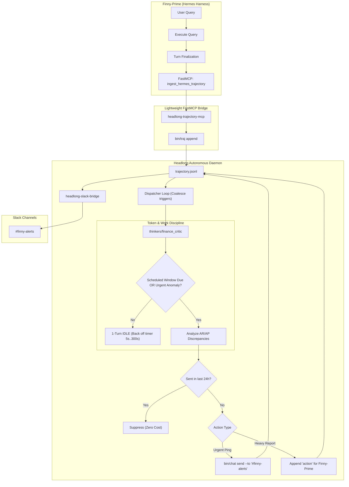

## Goal Capsule

- **Objective:** Enable Finny-Prime to forward conversation trajectories via an MCP service to a standalone Headlong instance, which monitors the finance trajectory stream within bounded token and time budgets, and proactively posts high-signal anomaly alerts and unasked reports to the `#finny-alerts` Slack channel or enqueues tasks for Finny-Prime.
- **Means:** Build a lightweight FastMCP service (`headlong-trajectory-mcp`) wrapping Headlong's `bin/traj append` and `bin/chat send`, with a dedicated finance critic thinker (`thinkers/finance_critic`) governed by scheduled time bands, exponential idle backoff, and strict output budgeting.
- **Product Authority:** Governs the MVP integration between Finny-Prime (Hermes harness), Headlong (autonomous persistent reasoning daemon), and Slack (`#finny-alerts`). Live automated write-backs to NetSuite are out of active scope.
- **Open Blockers:** None.

---

## Product Contract

### Summary
This project connects Finny-Prime (running on the Hermes Agent harness) with Headlong to provide proactive financial intelligence without runaway token consumption. Finny-Prime exports ShareGPT-format conversation trajectories to Headlong through a lightweight FastMCP bridge (`headlong-trajectory-mcp`). Inside Headlong, an autonomous background thinker (`finance_critic`) runs on bounded time bands and idle backoff. It identifies anomalies (such as unapplied wires, stale AP/AR balances, and unbilled receipts) from user queries and NetSuite context, then either alerts the `#finny-alerts` Slack channel or queues background follow-up tasks for Finny-Prime.

### Problem Frame
Finny-Prime is reactive: it answers questions when asked in Slack, but lacks an autonomous background process to inspect ERP trends, detect emerging discrepancies, or prepare unasked reports. Running heavy background polling inside Finny-Prime degrades interactive user latency and burns significant token budgets. Conversely, naive background agents that wake on every query rapidly exhaust API quotas and produce spam. Decoupling Finny-Prime from a dedicated persistent runtime (Headlong) equipped with exponential backoff, tiered memory rollups, and scheduled windows solves both latency and cost.

### Key Decisions
- **Decoupled Architecture**: Finny-Prime remains the interactive user-facing harness; Headlong runs as a standalone persistent daemon (`bin/thinkers`).
- **Lightweight FastMCP Bridge**: Trajectories are ingested into Headlong via a lightweight Python FastMCP server executing local CLI commands (`bin/traj append`, `bin/chat`).
- **Coalesced Ingestion**: Trajectory steps are appended atomically; rapid sequential user queries coalesce `observation` and `thought` steps (last-wins) in Headlong's dispatcher to prevent queue thrashing.
- **Token Budget Containment**:
  - *Tiered Memory (`recap`)*: Wake prompts use tiered context rollups; consecutive idle steps collapse into single lines (`"idle x22 over 2h10m"`).
  - *Exponential Backoff*: When no financial anomalies are detected, the thinker backs off exponentially ($5\text{s} \to 10\text{s} \to 20\text{s} \dots 300\text{s}+$).
  - *Blob Spilling*: Tool and NetSuite outputs over 4 KB spill to disk blobs, keeping the active prompt window compact.
- **Work Gating & Time Bands**:
  - *Scheduled Windows*: Heavy inspection runs only during configured time bands (e.g. 08:00 and 16:30 local time) via Headlong's harness-computed schedule signals.
  - *Routine Query Processing*: Outside scheduled windows, queries are ingested into trajectory memory, but the thinker quickly selects `idle` unless an explicit high-urgency anomaly is detected.
- **NetSuite Data Access Model**:
  - *Phase 1 (MVP)*: Passive observation of NetSuite tool outputs already present in the forwarded Finny-Prime trajectories.
  - *Phase 2 (Active)*: Read-only NetSuite MCP access configured in Headlong for scheduled window reconciliation checks.
- **Dual Delivery Modes**:
  - *Direct Slack Alert*: High-urgency anomalies are delivered to `#finny-alerts` via `bin/chat send` and `headlong-slack-bridge`.
  - *Task Enqueueing (Kanban)*: Complex reports that require significant interactive execution are queued as pending `action` tasks for Finny-Prime to pick up.

### Actors
- A1. **Finance User / Operator**: Queries Finny-Prime on Slack; receives proactive notifications and prepared reports in `#finny-alerts`.
- A2. **Finny-Prime (Hermes Harness)**: Executes interactive finance queries; exports conversation trajectories via the FastMCP bridge tool upon turn completion.
- A3. **Headlong Trajectory FastMCP Server**: Lightweight service receiving Hermes trajectories, normalizing them, and piping them into `bin/traj append`.
- A4. **Headlong Thinker (`finance_critic`)**: Evaluates incoming trajectory turns and financial signals; decides whether to idle, alert Slack, or enqueue a background task.
- A5. **Headlong Slack Bridge**: Outbound consumer that monitors `trajectory.jsonl` and delivers messages to Slack channels.

### Requirements

#### Trajectory Ingestion & FastMCP Bridge
- R1. The system shall provide a lightweight FastMCP server (`headlong-trajectory-mcp`) exposing tools `ingest_hermes_trajectory` and `append_trajectory_step`.
- R2. `ingest_hermes_trajectory` shall accept Hermes ShareGPT-formatted conversations (`from`, `value`, `timestamp`, `model`, `completed`) and convert them into sequential Headlong steps.
- R3. Ingested conversation turns with `from: "human"` or `from: "gpt"` (final response) shall map to Headlong `message` steps.
- R4. Ingested tool calls and tool responses shall map to Headlong `action` and `observation` steps respectively.
- R5. Each append operation shall invoke `bin/traj append` on the target identity's root trajectory to preserve atomic file locking (`.lock`) and trigger dispatcher FIFOs.

#### Pacing, Token Budget & Work Discipline
- R6. The dispatcher shall coalesce incoming `observation` and `thought` steps so that burst queries update pending triggers without creating duplicate concurrent thinker runs.
- R7. When a wake occurs outside scheduled windows and no urgent anomaly flag is present, `finance_critic` shall append an `idle` step and end the run in a single block without invoking secondary LLM tools.
- R8. When `finance_critic` idles, its scheduled wake timer shall back off exponentially up to a configurable cap (`FINANCE_CRITIC_BACKOFF_CAP`, default 300 seconds).
- R9. Deep anomaly analysis and unasked report generation shall run within defined scheduled windows (e.g. `--schedule "08:00 16:30"`), verified by harness clock signals rather than prompt arithmetic.
- R10. Prompts for `finance_critic` shall be bounded using `recap --context --budget`, collapsing older consecutive idle wakes and truncating tool outputs over 4096 bytes to blobs.

#### Proactive Outreach & Task Enqueueing
- R11. When an immediate alert is warranted, the thinker shall invoke `bin/chat send --to 'slack-finny-alerts'` with the alert content.
- R12. The system shall enforce 24-hour exact-text and key-based deduplication in `bin/chat send` to prevent duplicate alerts for the same underlying financial transaction.
- R13. When a proposed report requires heavy computation or user approval, `finance_critic` shall append a pending `action` step into the trajectory, signaling Finny-Prime to surface a draft review card on Slack.

---

### Quick MVP Setup & Pass/Fail Criteria

To validate the integration before committing to full-scale deployment, a standalone replay MVP is executed:

#### 1. MVP Execution Architecture
1. **Extraction**: Take an existing Hermes/Finny-Prime trajectory sample (from `trajectory_samples.jsonl` or exported session) containing NetSuite interactions (e.g. user querying customer AR aging, showing an overdue invoice alongside an unapplied credit or unbilled PO).
2. **Injection**: Start the local `headlong-trajectory-mcp` service and execute `ingest_hermes_trajectory` with the extracted payload targeting a test identity (e.g. `ada` or `finny-sub`).
3. **Observation & Response**: Let `thinkers/finance_critic` wake on the injected steps and evaluate its reaction in `trajectory.jsonl` and `#finny-alerts`.

#### 2. MVP Evaluation Metrics & Rubric

| Dimension | Passing Criteria (Pass) | Failing Criteria (Fail) |
| :--- | :--- | :--- |
| **Ingestion Integrity** | All turns mapped into `trajectory.jsonl` with valid `step_id`s, roles mapped to `message`/`action`/`observation`, and zero malformed JSON errors. | Dropped turns, missing timestamps, lock file contention, or broken JSON lines. |
| **Quality of Thinking** | Thinker step reflects accurate financial reasoning in `thought` (e.g. correctly links invoice `#1042` with payment wire `$240k`). | Hallucinated transaction IDs, incorrect dollar balances, or incoherent narrative loop. |
| **Observation Discipline** | Correctly extracts specific financial facts from tool blobs without overflowing context or repeating old facts. | Ingests huge raw JSON blobs verbatim into the prompt, overflowing model context. |
| **Quality of Alerts & Proactivity** | Sends a crisp, actionable finding to `#finny-alerts` that does one of two things: 1. **Highlights Anomaly**: Cites exact invoice/customer details and recommended reconciliation. 2. **Offers Work**: Proactively proposes: *"I can prepare the reconciliation journal for Acme Corp. Would you like me to queue this for Finny?"* | Generic noise (*"AR looks interesting today"*), duplicate pings, or complete failure to recognize the discrepancy. |
| **Token & Idle Behavior** | On a normal trajectory without discrepancies, executes **1-turn IDLE**, consumes <1k tokens, and sets exponential backoff. | Runs multi-turn loops, hallucinates tasks when none exist, or burns tokens repeatedly while idle. |

---

### Key Flows

- F1. **End-to-End Ingestion, Passive Review, and Bounded Idle**
  - **Trigger:** Finny-Prime completes an interactive user query regarding general invoice lookup.
  - **Actors:** A2 (Finny-Prime), A3 (FastMCP Server), A4 (Thinker).
  - **Steps:**
    1. Finny-Prime calls `ingest_hermes_trajectory` with the turn data.
    2. FastMCP normalizes the turns and pipes them to `bin/traj append`.
    3. Headlong dispatcher detects new steps via `dispatch.fifo` and wakes `finance_critic`.
    4. `finance_critic` inspects the recent context; observes no urgent anomaly and notes that the scheduled report window is not open.
    5. `finance_critic` records a single `idle` step, sets `FINAL="Idle — invoice query normal, next window 16:30"`, and arms its backoff timer.
  - **Covered by:** R1, R2, R5, R6, R7, R8, R10

- F2. **Scheduled Window Anomaly Detection and Slack Delivery**
  - **Trigger:** Dispatcher clock signal fires `DUE NOW` for the 08:00 window.
  - **Actors:** A4 (Thinker), A5 (Slack Bridge), A1 (Finance User).
  - **Steps:**
    1. Dispatcher triggers `finance_critic` with the scheduled window routing signal.
    2. `finance_critic` reviews open AR items against unapplied cash receipts from recent trajectory observations.
    3. A $240k unapplied wire matching an overdue invoice is identified.
    4. `finance_critic` runs `bin/chat send --to 'slack-finny-alerts' --key 'ar-reconcile/2026-11-19-0800'` with exact transaction IDs and amounts.
    5. `headlong-slack-bridge` posts the notification to `#finny-alerts`.
  - **Covered by:** R9, R11, R12

### Visualizations

### Acceptance Examples

- AE1. **Rapid Query Coalescing & Idle Backoff**
  - **Covers R6, R7, R8.**
  - **Given:** Finny-Prime sends 5 successive query trajectories within 15 seconds.
  - **When:** The FastMCP server appends each turn into Headlong.
  - **Then:** Headlong’s dispatcher coalesces the triggers, running `finance_critic` once, which appends an `idle` step and increases its backoff delay rather than executing 5 parallel LLM runs.

- AE2. **Scheduled Window Execution without Repetition**
  - **Covers R9, R11, R12.**
  - **Given:** The 08:00 scheduled window is marked `DUE NOW` by the harness clock.
  - **When:** `finance_critic` runs and posts an AP variance alert with key `ap-var/2026-11-19-0800`.
  - **Then:** The message is delivered to `#finny-alerts`, and subsequent wakes in that hour treat the window as `done` and refuse duplicate posts.

- AE3. **Task Delegation to Finny-Prime**
  - **Covers R13.**
  - **Given:** `finance_critic` discovers a complex discrepancy requiring 15 separate NetSuite customer invoice adjustments.
  - **When:** `finance_critic` evaluates that this exceeds direct chat scope.
  - **Then:** It appends an `action` step into the trajectory with instructions for Finny-Prime, avoiding burning its own execution tokens on manual adjustments.

### Scope Boundaries
- **In Scope (MVP):**
  - Lightweight FastMCP server wrapping `bin/traj append` and `bin/chat send`.
  - Conversion of Hermes ShareGPT JSON format to Headlong JSONL steps.
  - Token-contained `finance_critic` thinker with idle backoff and scheduled windows.
  - Direct alert delivery to `#finny-alerts` with exact-text deduplication.
  - Pending action enqueueing for multi-step tasks.
  - Quick replay test harness using historical Finny-Prime trajectories.
- **Deferred for Later:**
  - Active bidirectional WebSocket bridge streaming in-flight tokens before turn completion.
  - Direct automated NetSuite write-back / record updates without human approval.
  - Interactive multi-select Slack block kit components with interactive callback webhooks.

### Dependencies / Assumptions
- FastMCP running in Python 3.11+ on the Headlong host with access to `bin/traj` and `bin/chat`.
- Valid Slack bot credentials in `headlong-slack-bridge` with posting permissions in `#finny-alerts`.
- Finny-Prime configured to connect to the FastMCP endpoint via SSE or stdio transport.

### Sources / Research
- `design/monolith_backoff.md`: Non-blocking scheduled wake exponential backoff mechanics.
- `design/scheduled_goals.md`: Harness-computed time bands and deduplication keys.
- `design/output_budget_and_tool_cull.md`: Prompt token ceilings and output blob-spilling rules.
- `thinkers/_lib/common.sh`: Trajectory window compaction and idle step collapsing.
